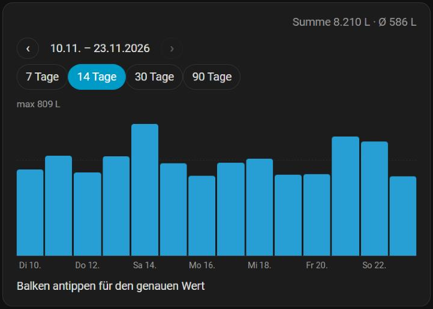

# Verbrauch-Karte

Verbrauch pro Stunde/Tag/Monat mit Zeitraumwahl und Blättern



## Installation

### Über den Marketplace (Home Assistant 2026.11 und neuer)

1. **Einstellungen** → **Marketplace** → **Aus Link hinzufügen**.
2. Die Adresse dieses Repositorys eintragen, Kategorie **Dashboard**.
3. **Verbrauch-Karte** installieren. Die Ressource wird dabei automatisch eingetragen.

### Über HACS (ältere Versionen)

**HACS** → ⋮ → **Benutzerdefinierte Repositories** → Adresse dieses Repositorys, Typ **Dashboard** → installieren.

### Manuell

`verbrauch-karte.js` nach `/config/www/` kopieren und unter **Einstellungen** → **Dashboards** → ⋮ → **Ressourcen**
als JavaScript-Modul `/local/verbrauch-karte.js` eintragen.

## Verwendung

```yaml
type: custom:verbrauch-karte
```

## Konfiguration

```
Verbrauch-Karte: Balken pro Stunde / Tag / Monat aus der Langzeitstatistik eines Zaehlers
(z. B. Wasser, Strom), mit waehlbarem Zeitraum und Blaettern zurueck/vor.

  type: custom:verbrauch-karte
  entity: sensor.wasserverbrauch_hauptzahler   # Zaehler mit state_class total/total_increasing
  titel: Verbrauch pro Tag
  periode: day            # hour | day | month
  farbe: "#29b6f6"        # optional
  zeitraeume: [{ t: "7 Tage", n: 7 }, ...]   # optional, n = Anzahl Balken
  standard: 14            # optional
```

## Lizenz

MIT
